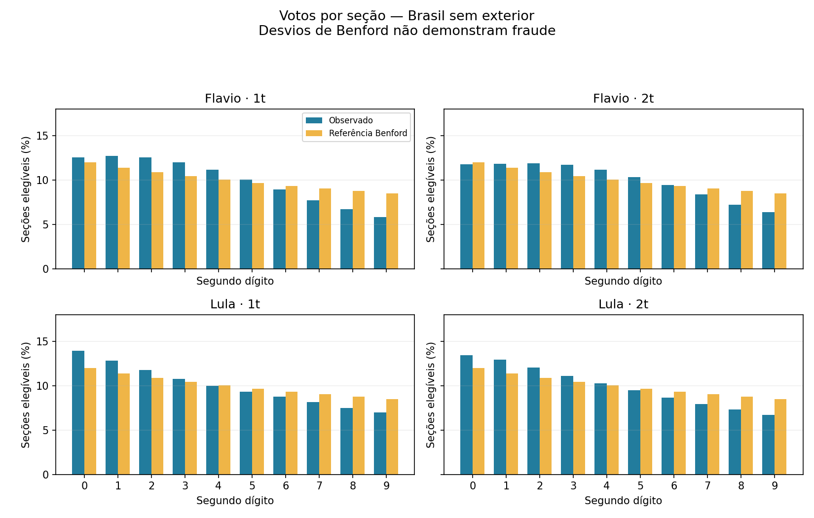

# Benford — diagnóstico exploratório dos votos por seção

Diagnóstico exploratório de dígitos. Desvio de Benford não demonstra fraude; aderência não certifica integridade. P-valores nominais pressupõem amostras independentes e uma distribuição de referência aplicável, condições não demonstradas nas seções eleitorais. Holm não corrige esses problemas.

## Resultado e interpretação

As tabelas medem distância de uma distribuição matemática de referência. Nenhum p-valor representa probabilidade de fraude ou de honestidade. O primeiro dígito é particularmente afetado pelos limites de tamanho das seções; o segundo também depende do processo eleitoral. Não foi construída uma linha de base de eleições comparáveis nem calibrado um detector de irregularidades.

## Brasil — sem exterior

| Candidato | Turno | Dígito | N elegível | MAD (pp) | Qui-quadrado | p nominal | p Holm |
|---|---:|---:|---:|---:|---:|---:|---:|
| Flavio | 1t | 1 | 497818 | 7.571 | 271941.12 | <1e-300 (subfluxo) | <1e-300 (subfluxo) |
| Flavio | 1t | 2 | 495420 | 1.307 | 11579.31 | <1e-300 (subfluxo) | <1e-300 (subfluxo) |
| Flavio | 2t | 1 | 497791 | 7.488 | 273437.79 | <1e-300 (subfluxo) | <1e-300 (subfluxo) |
| Flavio | 2t | 2 | 495292 | 0.912 | 6464.10 | <1e-300 (subfluxo) | <1e-300 (subfluxo) |
| Lula | 1t | 1 | 497889 | 7.081 | 223680.05 | <1e-300 (subfluxo) | <1e-300 (subfluxo) |
| Lula | 1t | 2 | 497599 | 0.918 | 5783.54 | <1e-300 (subfluxo) | <1e-300 (subfluxo) |
| Lula | 2t | 1 | 497893 | 7.933 | 297657.47 | <1e-300 (subfluxo) | <1e-300 (subfluxo) |
| Lula | 2t | 2 | 497722 | 1.026 | 6756.64 | <1e-300 (subfluxo) | <1e-300 (subfluxo) |

## Serrinha — BA

| Candidato | Turno | Dígito | N elegível | MAD (pp) | Qui-quadrado | p nominal | p Holm |
|---|---:|---:|---:|---:|---:|---:|---:|
| Flavio | 1t | 1 | 218 | 6.254 | 105.45 | 3.27e-19 | 1.99e-15 |
| Flavio | 1t | 2 | 216 | 1.482 | 6.53 | 0.685 | 1 |
| Flavio | 2t | 1 | 218 | 6.256 | 105.87 | 2.68e-19 | 1.63e-15 |
| Flavio | 2t | 2 | 216 | 2.064 | 10.85 | 0.286 | 1 |
| Lula | 1t | 1 | 218 | 10.498 | 244.52 | 2.5e-48 | 1.87e-44 |
| Lula | 1t | 2 | 218 | 1.429 | 6.17 | 0.723 | 1 |
| Lula | 2t | 1 | 218 | 11.518 | 235.11 | 2.45e-46 | 1.82e-42 |
| Lula | 2t | 2 | 218 | 2.673 | 21.60 | 0.0102 | 1 |

## Cobertura e método

499,248 seções distintas na base, incluindo exterior. 45,964 diagnósticos; 9,692 comparações com frequências esperadas suficientes. Cada teste territorial usa os votos de suas próprias seções, sem substituir municípios por dados estaduais. Zeros são preservados na cobertura, mas excluídos dos dígitos significativos. Valores de 1 a 9 não possuem segundo dígito e são excluídos somente nesse teste. Pequena amostra: frequências apresentadas, p-valor suprimido se alguma contagem esperada for menor que 5. Os níveis territoriais se sobrepõem; Holm usa uma família global. Dependência espacial e inadequação da hipótese de referência continuam não resolvidas.

## Proveniência e reprodução

Fonte congelada: `fa815fd6d1dd8935c1ca9d44ef5d548b26e9fd3d`. Derivados do repositório; autenticidade TSE não revalidada nesta execução.

Os 28 arquivos de seção são validados quanto a chaves duplicadas e contagens não negativas. Somas das frequências municipais reproduzem as UFs. SHA-256 de cada entrada, exclusões, frequências, probabilidades esperadas e resultados municipais estão em `resultados.json.gz`.

Executar na raiz: `python scripts/aplicar_benford.py` (numpy, scipy e matplotlib).

## Referências

https://authors.library.caltech.edu/records/5jbtk-8wn05

https://doi.org/10.1093/pan/mpr024
